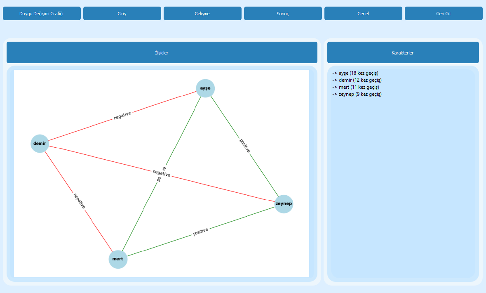

# Turkish Fairy Tale Character Relations

Detects the characters in a Turkish fairy tale, extracts the relationships between them and labels each relationship as positive or negative. Results are shown in a desktop app as a character network and a sentiment curve across the story.



## Features

- **Character detection:** spaCy NER plus the subjects of verbs that describe human actions; different mentions of the same character are merged under one name, and characters mentioned fewer than 4 times are dropped.
- **Relationship extraction:** pronoun resolution and co-occurrence of characters within a sentence.
- **Relationship polarity:** sentence sentiment from a Turkish BERT model, aggregated per character pair by majority vote.
- **Visualization:** character network for the whole story and for its beginning, middle and end; sentiment curve over the story.
- **Evaluation:** scripts that score the output against a hand-annotated gold standard of 25 tales.

Only pre-trained models are used ([`tr_core_news_trf`](https://huggingface.co/turkish-nlp-suite/tr_core_news_trf) and [`savasy/bert-base-turkish-sentiment-cased`](https://huggingface.co/savasy/bert-base-turkish-sentiment-cased)); no model is trained in this project.

## Installation

Tested with Python 3.10.11.

```bash
python -m venv venv
venv\Scripts\activate            # Windows
# source venv/bin/activate       # Linux / macOS

pip install -r requirements.txt
pip install --no-deps https://huggingface.co/turkish-nlp-suite/tr_core_news_trf/resolve/main/tr_core_news_trf-1.0-py3-none-any.whl
```

The spaCy model is about 850 MB. The sentiment model is downloaded from Hugging Face on first run.

`--no-deps` keeps the versions pinned in `requirements.txt`. The model's metadata asks for older `transformers` and `tokenizers` versions, so `pip check` reports a conflict for `tr-core-news-trf`; the results below were produced with exactly this setup (Python 3.10).

## Usage

### Desktop app

```bash
python main.py
```

Click **Hikaye Seç** (Select story) to choose a UTF-8 `.txt` file, then **Analiz Et** (Analyze). Sample tales are in `NLP-Hikayeler/hikayeler/` and `examples/`.

### Evaluation

```bash
python run_baseline.py    # run the pipeline on all 25 tales -> predictions.json
python evaluation.py      # score predictions.json against test_data/annotations/ -> before_metrics.json, before_metrics.txt
python metrik_raporu.py   # all result tables -> reports/metrik_raporu.html, reports/metrik_raporu.md
```

`evaluation.py` reports every score in the results table except relationships between main characters; that row comes from `metrik_raporu.py`. `karakter_tablolari.py` and `iliski_tablolari.py` write the same tables in LaTeX to `reports/`.

## Example

`examples/cesurayse.txt` is a short tale that is not part of the evaluation set. The system finds all four characters (Ayşe, Zeynep, Mert, Demir) and all six relationships with the same polarities as the hand annotation in `examples/cesurayse.json`.

## Results

Scores on the 25-tale gold standard (%):

| Task | Set | Precision | Recall | Micro-F1 | Macro-F1 |
|---|---|---|---|---|---|
| Characters | Main | 86.7 | 86.7 | 86.7 | 88.7 |
| Characters | All | 82.8 | 73.8 | 78.0 | 78.6 |
| Relationships | Main | 100.0 | 86.4 | 92.7 | 60.0 |
| Relationships | All | 51.9 | 64.4 | 57.5 | 61.0 |

Polarity is the weakest stage: 42.0% of positive and negative gold relationships receive the correct label (positive 42.2%, negative 41.7%).

## Limitations

- The sentiment model is binary, so neutral relationships are left out of polarity scoring.
- Sentence sentiment does not always reflect the relationship: a sad scene between two friends reads as negative.
- Different names of the same character are sometimes kept apart, which creates spurious relationships.
- The dataset is small (25 tales).

## Data

- `NLP-Hikayeler/hikayeler/`: 25 Turkish fairy tales (about 2,236 sentences), provided by Prof. Dr. Banu Diri.
- `test_data/annotations/`: gold standard with 130 characters (45 main) and 146 relationships (102 positive, 36 negative, 8 neutral).
- Annotation guidelines: [ANNOTATION_RULES.md](test_data/annotations/ANNOTATION_RULES.md) (in Turkish).

## Project structure

```
├── main.py                   entry point of the desktop app
├── mainwindow.py             PyQt5 interface
├── analizClass.py            character detection
├── iliskiClass.py            relationship extraction and sentiment
├── run_baseline.py           batch run over the corpus
├── evaluation.py             scoring against the gold standard
├── metrik_raporu.py          HTML and Markdown report of all result tables
├── karakter_tablolari.py     character detection tables (LaTeX)
├── iliski_tablolari.py       relationship tables (LaTeX)
├── NLP-Hikayeler/hikayeler/  tale corpus
├── test_data/annotations/    gold standard and annotation rules
└── examples/                 demo tale outside the evaluation set
```

## Authors

Ömer Genç, Erdem Açıkel

## Acknowledgements

We thank Prof. Dr. Banu Diri for her supervision and for providing the tale corpus.
